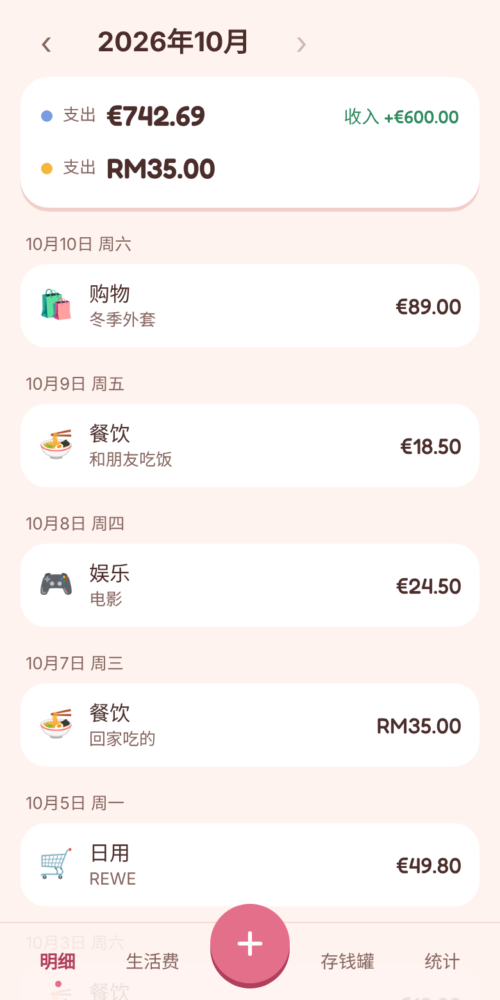
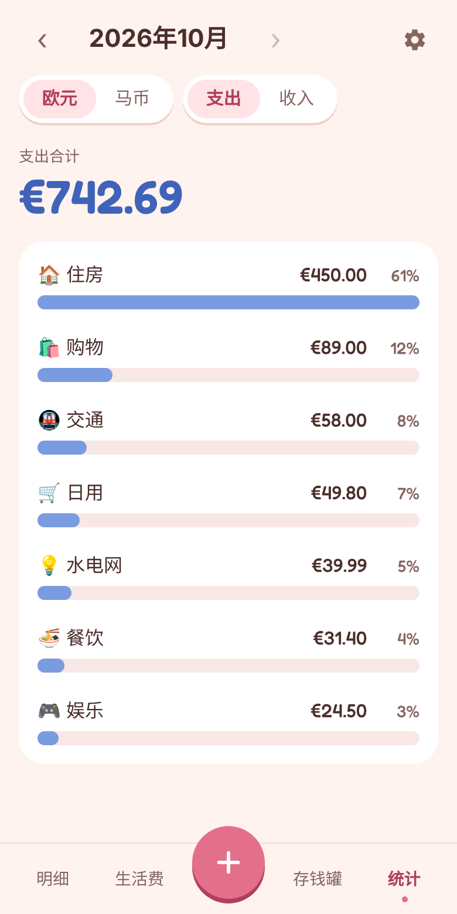
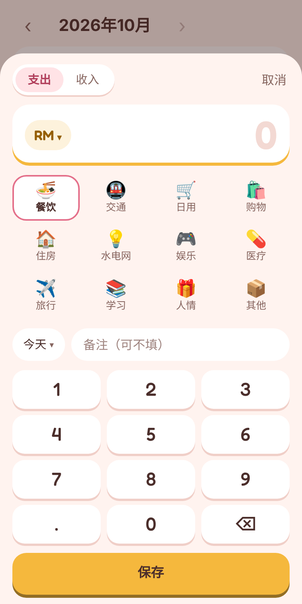

# Jizhang 记账 — Offline-first Expense Tracker PWA

A mobile-first expense tracker I built for my own life as an international student in Germany: personal spending in **EUR / MYR / USD**, plus a **shared household budget** that syncs between two phones and settles up automatically at the end of each month.

**Live app:** https://shanetcy.github.io/jizhang/ (open on your phone and use "Add to Home Screen" for offline use)

<p align="center">
  
  
  
  
</p>

## Features

- **Personal ledger, local only.** Data lives on the device in IndexedDB. Nothing is uploaded; JSON export/import serves as backup.
- **Multi-currency without conversion.** EUR, MYR and USD are tracked and totalled separately, because converting at today's rate misrepresents what was actually spent.
- **Shared household budget.** Two people log shared expenses from their own phones. The app records who paid, splits everything 50/50, and works out the single transfer needed to settle the month.
- **Piggy bank.** Whatever is left of the monthly budget rolls into savings automatically; withdrawals are logged with a purpose.
- **Works offline.** Installable PWA with a service worker; shared entries made offline sync when the phone reconnects (Firestore offline cache).
- **Fast entry.** Custom keypad, category grid, and the last-used currency is remembered.

## Tech stack

| Area | Choice |
| --- | --- |
| Frontend | React 19, TypeScript, Vite |
| Local storage | Dexie (IndexedDB) with live queries |
| Sync & auth | Firebase Auth (email/password), Cloud Firestore with offline persistence |
| Offline / install | vite-plugin-pwa (Workbox service worker, web manifest) |
| Deployment | GitHub Pages via a small deploy script (`gh-pages` branch) |

## Design decisions

- **Money is stored as integer cents** (`src/money.ts`) to avoid floating-point rounding errors.
- **Settlement logic is a set of pure functions** (`src/settle.ts`): monthly summary, who owes whom (half the difference of what each paid), overspend handling and piggy-bank balance. This keeps the business rules separate from the UI and easy to reason about.
- **Security lives in Firestore rules** (`firestore.rules`): only the two members of a household can read or write it; a new member can only add *themselves*, and only via an invite code while the household has one member. Invite codes can be fetched individually but never listed.
- **Privacy by default:** the personal ledger never leaves the device; only the shared budget is synced.
- **Deleted categories are archived, not removed,** so old transactions still display correctly.

## Project structure

```
src/
  db.ts            IndexedDB schema (Dexie), default categories, backup export/import
  cloud.ts         Firestore access for the shared household
  settle.ts        Pure functions: monthly settlement, budgets, piggy bank
  money.ts         Currencies, cent-based formatting and parsing
  pages/           List, Shared budget, Piggy bank, Stats, Settings
  components/      Entry sheet (keypad), month switcher, modals, account section
firestore.rules    Security rules for the shared ledger
```

## Running locally

```sh
npm install
npm run dev      # dev server, reachable from a phone on the same Wi-Fi
npm run build    # type-check and production build
npm run deploy   # build and publish to GitHub Pages
```

To test the shared ledger without touching real data, use the Firebase emulators (requires Java):

```sh
npx firebase emulators:start --only auth,firestore --project demo-jizhang
VITE_FIREBASE_EMULATOR=1 npm run dev
```

The Firebase web config in `src/firebase-config.ts` is public by design (it ships to every browser); access control is enforced by `firestore.rules`.

---

## 中文说明

个人记账 PWA，支持欧元 / 马币 / 美元（分开统计，不换算），个人账本只存在手机本机（IndexedDB）。另有和伴侣共用的“生活费”账本，通过 Firebase 在两台手机间同步，月底自动算出谁该转给谁，结余存进存钱罐。

设计和开发计划见 [PLAN.md](PLAN.md)。
